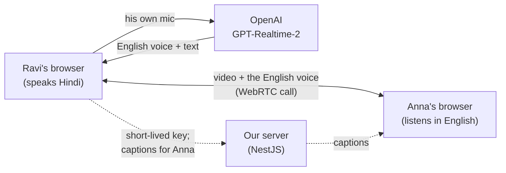

# Meet Translate (OpenAI + Gemini)

Video calls in Hindi, Telugu and English where each person hears the other
in their own language, with live captions. Translation is done by realtime
voice models -- two from OpenAI and one from Google, picked per meeting, so
they can be compared on real calls.

It started as an OpenAI-only experiment (hence the repo name); Google's
Gemini 3.5 Live Translate was added later and did best in our own tests.

**Live:** https://openai-meet-translate.vercel.app (creating a meeting needs
an access code; joining needs only the invite link)

A sibling of [Meet Translate](https://github.com/mujeebmasi/meeting-translate),
which builds the same thing from separate parts (local speech-to-text, an LLM
translator, a text-to-speech voice). This one hands all of that to a single
model -- and turned out to need a lot of work around it to behave in a
real call (see [Problems found in real calls](#problems-found-in-real-calls)).

## At a glance

- **One-to-one video calls** (WebRTC), with a TURN relay for networks that
  block direct connections.
- **Directions:** all six between Hindi, Telugu and English. Everyone hears
  the other person in the language they picked under "I speak".
- **Three models**, picked per meeting:
  - **GPT-Realtime-2** (default): OpenAI's voice-assistant model, turned
    into an interpreter by our own prompt. Translates after each sentence.
    All six directions.
  - **GPT-Realtime-Translate**: OpenAI's dedicated interpreter. Translates
    while the speaker is still talking, but takes no instructions, and can't
    speak Telugu -- so only into English here.
  - **Gemini 3.5 Live Translate**: Google's dedicated interpreter. Also
    translates while the speaker talks and takes no instructions, but speaks
    Telugu too: all six directions.
- **Captions** for both sides: the listener sees the translation, the
  speaker sees how they were understood ("You → Telugu"). Under each line:
  how long they spoke and how fast the translated voice followed.
- **Stack:** Next.js (frontend, on Vercel), NestJS + Socket.IO (backend, on
  Render), OpenAI Realtime API over WebRTC, Gemini Live API over WebSocket.
  No database: meetings live in memory.

## The site

| Page | What's on it |
|---|---|
| `/` | What the app does, the measured numbers for GPT-Realtime-2 and Gemini side by side (see [Results](#results)), how it works in three steps, and **Let's Get Started**. It also starts waking the free server while you read. |
| `/start` | One card with a **Start / Join** switch. Starting: a meeting name, the translator as three option cards (GPT-Realtime-2 *Recommended*, GPT-Realtime-Translate *Fastest start*, Gemini Live Translate *Experimental*), and the access code, hidden like a password. Joining: just the invite link or code. |
| `/m/<code>` | The call: both video tiles, the language switch, captions with the timing under each line, mute / camera / translate controls. |

## How it works



1. **The call:** the two browsers connect straight to each other (WebRTC).
   The server only introduces them (Socket.IO) and keeps the list of who's
   in which meeting.
2. **Each speaker translates their own voice.** Their browser sends its mic
   to OpenAI over a second WebRTC connection; the translated voice that
   comes back *replaces* their voice in what the listener receives (the
   call's audio track is swapped, no reconnecting). Captions go to the
   listener through our server.
3. **The browser decides when a sentence has ended**
   ([pause-detector.ts](frontend/src/lib/pause-detector.ts)): 0.5 s of quiet,
   measured against the speaker's own background noise. It then asks OpenAI
   to translate that sentence -- and only that sentence, plus the last few
   translations as text for context
   ([realtime2-session.ts](frontend/src/lib/realtime2-session.ts)).
   Translations play one at a time, so none gets cut off.
4. **The API key stays on the server.** The browser gets a short-lived key
   for one session; the server also sets the interpreter prompt
   ([interpreter-prompt.ts](backend/src/openai/interpreter-prompt.ts)), the
   languages, and a male voice speaking 1.2× fast.
5. **Gemini works differently** ([gemini-session.ts](frontend/src/lib/gemini-session.ts)):
   Google's Live API has no WebRTC, only a WebSocket carrying raw audio. So
   the browser does the audio work itself -- the mic is turned into 16 kHz
   samples and sent every 100 ms, and Gemini's 24 kHz reply is played into
   an audio track that replaces the speaker's voice on the call. There's no
   pause detection: it translates continuously. The server's one-use token
   ([gemini.service.ts](backend/src/openai/gemini.service.ts)) is locked to
   the model and the listener's language.

## Results

**Real calls** (two people, two networks, laptop mics):

- **Telugu → Hindi:** 7 of 7 lines right in a scripted conversation --
  including "parledu" → "कोई बात नहीं" (no problem), "naalugu lakshalu" → "4
  lakhs", and "2:30" even where the transcript under it misheard the time.
- **Hindi → English:** 10 of 11 right (one line too unclear to judge).
  "Koi baat nahi, ho jaata hai" → "No problem, it happens", although the
  transcript dropped "koi": this model hears the voice, not the transcript.
- Everyday English words stay English ("budget", "report", "email"), the
  way people actually talk.

**Speed:** the translated voice starts **~1.1–1.5 s after the speaker stops**
(0.5 s to be sure the sentence ended, then ~0.6–1.0 s). A sentence that
ends while the previous translation is still playing waits its turn.

**Cost (GPT-Realtime-2):** about **₹0.3–0.5 for a short sentence, ~₹1.5 for a
long one**; silence is close to free. Every finished line is in the server
log with its cost and timing.

**Gemini 3.5 Live Translate** (first tests, 14 Oct 2026):

- **Real call, English → Telugu:** translations right, apart from one
  phrase dropped ("in real time"); the voice ran **under ~2 s behind** the
  speaker, translating while they talked.
- **Recorded Hindi clip:** right into English ("How are you? Let's start
  today's meeting.") and into Telugu; the translated voice started **~3.4 s
  after the speaker started**, before the 3.9 s sentence had ended.
- **Cost:** Google's price is about **$0.037 a minute (~₹3)**, input and
  output audio, silence included.
- Not tested yet: a Telugu speaker as the source, and long calls.

## Compared with Meet Translate

| | Meet Translate (own pipeline) | This app (GPT-Realtime-2) |
|---|---|---|
| Voice starts | ~1.4 s after the sentence ends | ~1.1–1.5 s after the sentence ends |
| Hindi / Telugu accuracy (real voice) | 7/7 and 7/7 | 10/11 and 7/7 |
| Directions | Hindi, Telugu, Tamil, Kannada → English | All six between Hindi, Telugu and English |
| Cost, 30-minute call | ~₹8 | ~₹30–60 (estimate) |
| Hosting | own laptop + ngrok (₹0, only while it's on) | Vercel + Render free (always online; sleeps after 15 idle min) |
| Code | ~3,000 lines, 3 services incl. a speech model | ~2,200 lines, 2 services |

Same speed, similar accuracy. The own pipeline is several times cheaper and
covers more languages; this one is simpler to run and host.

## The three models

OpenAI's dedicated interpreter model was tried first. On 13 real Hindi sentences
it got **8 right, 2 partly, 3 wrong**, and real Telugu much worse:

| Said | GPT-Realtime-Translate | GPT-Realtime-2 + our prompt |
|---|---|---|
| Kya aapne client se baat ki? | "Please speak with the client." ❌ | "Did you talk to the client?" ✅ |
| Ye kaam toh baayein haath ka khel hai | "You can do this work manually." ❌ | "This work is a piece of cake." ✅ |
| Budget do lakh pachaas hazaar | "two lakh", then "two hundred and fifty thousand" (both spoken) | "two lakh fifty thousand rupees" ✅ |

| | GPT-Realtime-Translate | GPT-Realtime-2 | Gemini 3.5 Live Translate |
|---|---|---|---|
| Translation starts | while the speaker is talking | after each sentence | while the speaker is talking |
| Wrong guesses spoken aloud | yes: Hindi puts the verb and "kya" last, so it guesses early and corrects itself out loud | no | none seen yet |
| Takes instructions | no | yes | no |
| Speaks Telugu (Hindi ↔ Telugu, English → Telugu) | no | yes | yes |
| Connection | WebRTC | WebRTC | WebSocket, raw audio |
| Cost | $0.034/min, silence included | per token | ~$0.037/min, silence included |

Our ranking after the first real calls: **Gemini first** (translates as you
talk, all directions, good Telugu), then GPT-Realtime-2 (most controllable,
but waits for each sentence), then GPT-Realtime-Translate.

## Problems found in real calls

Each of these showed up with real people, and each fix is in the code with
a comment saying why:

| Problem | Cause | Fix |
|---|---|---|
| Telugu "send the report" came out as "**I** will send the report" | The prompt said "speak in the first person"; Telugu marks "you" only in the verb ending | A rule: keep who does what exactly as said |
| After a "hmm" or unclear speech, it **repeated the previous translation** | Each reply saw the whole call, so with nothing new it fell back on the last thing it said | Each reply sees only the new speech; filler sounds aren't sent |
| A question after a few statements got **answered** ("Yeah, I spoke with the client") | It's a voice-assistant model | A short reminder right after every new speech: a question stays a question |
| The next sentence **cut off** the translation still playing | OpenAI's own pause detection clears playing audio when the speaker starts again, even with "don't interrupt" set | Pauses found in the browser instead; the next translation waits until the last is fully *heard* |
| **Made-up sentences** from breathing or background noise | Given a noise, the model often invents a sentence | Short sounds are translated only if the speech-to-text finds real words in them |
| **Nothing translated** for some speakers | A soft voice stayed under the loudness threshold; on a noisy line the noise counted as endless speech | Lower threshold; background noise learned all the time |
| Real calls **much slower** than Meet Translate | The listener's browser used to translate, so the voice first crossed the call's (relayed) connection | Translation moved to the speaker's side, on their clean mic |
| The page **went quiet** when the free server restarted | Meetings live in memory | A clear "the server restarted, create a new meeting" message |
| Google **rejected the Gemini token request** | Google's docs name the settings field `liveConnectConstraints`, but that's only the SDK's name; the REST API wants `bidiGenerateContentSetup` | Sent what Google's own SDK sends (found by reading the SDK's source) |

## Running it

Needs Node.js and an OpenAI API key with credit; a Gemini API key
(aistudio.google.com/apikey) for Gemini meetings.

```bash
cd backend && cp .env.example .env   # then put OPENAI_API_KEY and GEMINI_API_KEY in .env
npm install && npm run start:dev     # http://localhost:4100

cd frontend && npm install && npm run dev   # http://localhost:3100
```

Open http://localhost:3100, create a meeting, and join from two devices (or
two browsers with headphones, to avoid echo). Tests: `cd backend && npm test`.

## Deploying it (free: Vercel + Render)

| Part | Where | Settings |
|---|---|---|
| Backend (NestJS + Socket.IO) | **Render**, free web service | `render.yaml` in this repo: New → Blueprint. Fill in `OPENAI_API_KEY`, `GEMINI_API_KEY`, `ACCESS_CODE`, `FRONTEND_URL` (the Vercel address) and the TURN login |
| Frontend (Next.js) | **Vercel** | Root directory `frontend`; env (type *Config*) `NEXT_PUBLIC_API_URL=https://<render-address>/api` and `NEXT_PUBLIC_WS_URL=https://<render-address>` |

- **Access code:** creating a meeting needs it, so a stranger with the link
  can't run up the OpenAI or Google bill. A monthly budget limit on both
  accounts is a good second guard.
- **TURN relay:** between two home networks the call often only connects
  through it ("Can't connect on this network" without it). ExpressTURN's
  free tier works.
- **Free-plan trade-off:** Render sleeps after ~15 idle minutes; the next
  visit wakes it in 30–60 s, and open meetings are forgotten.

## Limits

- One-to-one calls only, and no saved transcripts (no database, on purpose).
- GPT-Realtime-2 waits for each sentence to end; a long speech is translated
  in pieces of at most 15 s.
- OpenAI's models accept Hindi and Telugu as input but not Tamil or Kannada
  (so the app offers just Hindi, Telugu and English).
- Gemini translates everything the mic hears: a video playing in the
  background got translated too in a real test. Use headphones.
- Google doesn't document how long a Gemini Live Translate session may last;
  if one ends, switching translation off and on starts a new one.
- On one laptop with two browsers, or with Discord also open on speakers,
  sound leaks between the apps' microphones -- use headphones.

## What's next

Researched, not built yet:

- **GPT-Realtime-2.1**: same price as GPT-Realtime-2, with better silence,
  noise and number handling according to OpenAI -- a one-line upgrade.
- **GPT-Realtime-2.1-mini**: about 3× cheaper audio; needs testing on Hindi
  and Telugu.
- **Gemini as the default**, once a real Telugu speaker and a long call have
  been tried.
- **Gemini 3.8 Live** (Google's assistant model, not the translator): takes
  instructions like GPT-Realtime-2,
  audio roughly a tenth of the price per token, a free tier, and Hindi and
  Telugu support. WebSocket only (no WebRTC), and sessions are capped at 15
  minutes, so it's about half a day of work.
- **A TURN relay closer to India** (e.g. Cloudflare's), now that the
  translated voice travels over the call.
