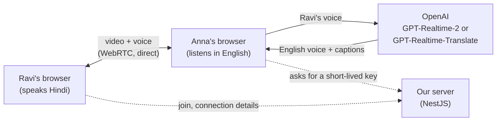

# Meet Translate (OpenAI)

Video calls where Hindi and Telugu speakers are heard in English, with live
English captions. Translation is done by one of two OpenAI voice models,
picked when the meeting is created:

- **GPT-Realtime-2** (default): OpenAI's voice-assistant model, turned into
  an interpreter by our own prompt. Translates after each pause, into English
  and also between Hindi and Telugu.
- **GPT-Realtime-Translate**: OpenAI's dedicated interpreter model.
  Translates while the speaker is still talking, but takes no instructions.

A simpler sibling of [Meet Translate](https://github.com/mujeebmasi/meeting-translate),
which builds the same thing from separate parts (local speech-to-text, an LLM
translator, a text-to-speech voice) and waits for each sentence to end.

## How it works



1. **Video call:** one-to-one -- a Hindi/Telugu speaker and an English
   listener. The browsers connect straight to each other (WebRTC); the
   server only introduces them (Socket.IO) and keeps the list of who is in
   which meeting, in memory.
2. **Translation:** an English listener's browser opens a second WebRTC
   connection, to OpenAI, and sends it the Hindi/Telugu speaker's voice as
   received on the call. English speech comes back as an audio track and
   the captions on a data channel.
3. **The API key stays on the server.** The browser asks our server for a
   short-lived key that works for one translation session only. For
   GPT-Realtime-2, the server also sets the interpreter prompt
   ([interpreter-prompt.ts](backend/src/openai/interpreter-prompt.ts)) and
   the speaker's language.
4. The listener hears only the English voice: the speaker's own voice is
   muted while the translation runs. Trade-off: the translator stays quiet
   for words already spoken in English ("meeting", "okay"), so those are
   only in the captions.

## Measured

A Hindi and a Telugu sentence (generated speech, played into the call as
the speaker's mic), with an English listener in a second window:

| | Hindi | Telugu |
|---|---|---|
| First English caption | 1.3 s after the speaker **started** | 1.3 s after the speaker **started** |
| Last English words | ~0.5 s after the speaker stopped | ~0.5 s after the speaker stopped |
| Result | "Hello, and welcome to today's meeting. We'll discuss the new project. Please send the report by tomorrow evening. Okay." | "Hello. In today's meeting, let's talk about the new project. Send the report by tomorrow." |

Both translations were correct. The English keeps pace with the speaker
instead of waiting for the sentence to end: Meet Translate shows its caption
about 1 s *after* a sentence ends.

### A real-voice test

13 everyday Hindi sentences spoken into a laptop mic: **8 translated
right, 2 partly, 3 wrong**. What went wrong, and why:

- **It guesses early, then corrects itself out loud.** Hindi puts the verb
  and the question word at the end ("kal wala issue fix ho gaya *kya*?").
  The model starts speaking before it gets there, so the listener heard
  "Yes, the previous issue is fixed" and then "Is the previous issue
  fixed?". Same with a number: "two lakh", then "two hundred and fifty
  thousand". It's the price of translating while someone is still talking.
- **Idioms come out literally**: "baayein haath ka khel" (a piece of cake)
  became "you can do this work manually".
- **Mishearing comes first**: where the Hindi transcript was wrong, so was
  the English.
- **Real Telugu speech went much worse than Hindi**, though the clean
  generated Telugu sentence above was fine. The model accepts no prompts or
  glossaries, so there's nothing in this app to tune it with.

## GPT-Realtime-2 vs GPT-Realtime-Translate

The sentences the dedicated model got wrong, now through GPT-Realtime-2 with
our prompt (generated speech; the prompt contains none of these examples):

| Said | GPT-Realtime-Translate | GPT-Realtime-2 + our prompt |
|---|---|---|
| Kya aapne client se baat ki? | "Please speak with the client." ❌ | "Did you talk to the client?" ✅ |
| Ye kaam toh baayein haath ka khel hai | "You can do this work manually." ❌ | "This work is a piece of cake." ✅ |
| Budget do lakh pachaas hazaar rupaye | "two lakh", then "two hundred and fifty thousand" (both spoken) | "two lakh fifty thousand rupees" ✅ |
| Repatiloga report pampinchandi (Telugu) | ✅ | ✅ "You should send the report by tomorrow." |
| Report eppudu pampistaru? (Telugu) | – | ✅ "When will you send the report?" |

The two Telugu lines first came out as "*I* will send…" and "When will *I*
send…": the prompt said to speak "in the first person", and Telugu shows
"you" only in the verb ending. One added rule ("keep who does what exactly
as they said it") fixed both -- the kind of fix the dedicated model, which
takes no prompt, doesn't allow.

| | GPT-Realtime-Translate | GPT-Realtime-2 |
|---|---|---|
| English starts | while the speaker is talking (~1.3 s in) | after they pause: voice ~0.6–0.8 s after the pause is noticed |
| Wrong guesses spoken aloud | yes (it starts before the verb) | no (it hears the whole sentence) |
| Takes instructions | no | yes |
| Hindi ↔ Telugu | no (can't speak Telugu) | yes |
| Voice | follows the speaker's own tone | one fixed male voice (`cedar`) |
| Cost | $0.034/min, silence included | per token: ~$0.004–0.006 a short sentence, nothing for silence or a skipped "hmm" |

The server log shows each line with what it cost and how fast it came
(gpt-realtime-2 only).

### A real-voice test (GPT-Realtime-2)

23 lines from a real voice on a laptop mic, Hindi and Telugu, into English
and between Hindi and Telugu. The lines the other model got wrong came out
right this time: "kya aapne client se baat ki" stayed a question, "koi baat
nahi, ho jaata hai" became "No problem, it happens" even though the
transcript under it dropped "koi" (this model hears the voice, not the
transcript), and "baayein haath ka khel" became "It's a piece of cake".
Hindi → Telugu and Telugu → Hindi worked, keeping everyday English words
("app", "accurate", "model") the way people actually speak.

One problem showed up: **after a "hmm", a laugh, or something unclear, it
repeated its previous translation**. Each reply was being given the whole
call, so with nothing new to say it fell back on the last thing it said. Two
fixes, in [realtime2-session.ts](frontend/src/lib/realtime2-session.ts):

- each reply now gets **only the new speech**, plus the last few
  translations as text marked "already said, never repeat" -- so there's no
  earlier answer for it to fall back on. A side effect: replies got faster
  (the voice now starts ~0.6–0.8 s after the pause is noticed, was ~1.0 s)
  and their cost no longer grows as the call gets longer;
- a pause holding only a filler sound ("hmm", "umm", "hun", a short laugh)
  isn't sent for translation at all. "हाँ" ("yes") still is.

## Languages

English, Hindi and Telugu. Everyone hears the others in the language they
picked under "I speak":

- Hindi or Telugu → English, with either model;
- Hindi ↔ Telugu, with GPT-Realtime-2 only (GPT-Realtime-Translate can't
  speak Telugu). In a Hindi + Telugu call both sides translate, so it costs
  twice as much.

OpenAI's models accept Hindi and Telugu as input but not Tamil or Kannada.

## Cost

- **GPT-Realtime-Translate:** $0.034 a minute (about ₹3) for as long as the
  call lasts, silence included. A 30-minute call is about ₹90.
- **GPT-Realtime-2:** billed per token, so silence is almost free; about
  ₹0.3–0.5 for a short sentence, ~₹1.5 for a long one, in our tests.

Unticking **Translate to …** stops either at once.

## Running it

Needs Node.js and an OpenAI API key with credit.

```bash
cd backend && cp .env.example .env   # then put your OPENAI_API_KEY in .env
npm install && npm run start:dev     # http://localhost:4100

cd frontend && npm install && npm run dev   # http://localhost:3100
```

Open http://localhost:3100, create a meeting, join as English in one window
and as Hindi in another (a different device, or headphones, to avoid echo).

Tests: `cd backend && npm test`.

## Deploying it (free: Vercel + Render)

Nothing heavy runs on our side -- all the AI is at OpenAI -- so free hosting
is enough:

| Part | Where | Settings |
|---|---|---|
| Backend (NestJS + Socket.IO) | **Render**, free web service | `render.yaml` in this repo: New → Blueprint. Fill in `OPENAI_API_KEY`, `ACCESS_CODE`, `FRONTEND_URL` (the Vercel address) and, optionally, the TURN login |
| Frontend (Next.js) | **Vercel** | Root directory `frontend`; env `NEXT_PUBLIC_API_URL=https://<render-address>/api` and `NEXT_PUBLIC_WS_URL=https://<render-address>` |

On a public link, **creating a meeting needs the access code** (joining
needs only the meeting link), so a stranger can't run up the OpenAI bill. A
monthly budget limit on the OpenAI account is a good second guard.

Free-plan trade-off: Render puts the backend to sleep after ~15 minutes with
no visitors. The next visit wakes it in 30-60 s (the home page says "Waking
the server up..." meanwhile), and meetings, kept in memory, are forgotten.

## Not in this first version

Kept out on purpose, to start simple: a database (meetings are forgotten on
restart), saved transcripts, captions for the speaker, and a daily usage
limit (the access code and OpenAI's own budget limit guard the bill).
