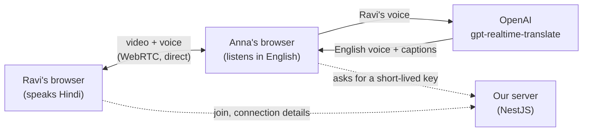

# Meet Translate (OpenAI)

Video calls where Hindi and Telugu speakers are heard in English **while
they are still talking**, with live English captions. Translation is done by
OpenAI's [`gpt-realtime-translate`](https://developers.openai.com/api/docs/guides/realtime-translation).

A simpler sibling of [Meet Translate](https://github.com/mujeebmasi/meeting-translate),
which builds the same thing from separate parts (local speech-to-text, an LLM
translator, a text-to-speech voice) and waits for each sentence to end.

## How it works



1. **Video call:** one-to-one -- a Hindi/Telugu speaker and an English
   listener. The browsers connect straight to each other (WebRTC); the
   server only introduces them (Socket.IO) and keeps the list of who is in
   which meeting, in memory.
2. **Translation:** an English listener's browser opens a second WebRTC
   connection, to OpenAI, and sends it the Hindi/Telugu speaker's voice as
   received on the call. English speech comes back as an audio track and
   the captions on a data channel.
3. **The API key stays on the server.** The browser asks our server for a
   short-lived key that works for one translation session only.
4. The listener hears only the English voice: the speaker's own voice is
   muted while the translation runs. Trade-off: the translator stays quiet
   for words already spoken in English ("meeting", "okay"), so those are
   only in the captions.

## Measured

A Hindi and a Telugu sentence (generated speech, played into the call as
the speaker's mic), with an English listener in a second window:

| | Hindi | Telugu |
|---|---|---|
| First English caption | 1.3 s after the speaker **started** | 1.3 s after the speaker **started** |
| Last English words | ~0.5 s after the speaker stopped | ~0.5 s after the speaker stopped |
| Result | "Hello, and welcome to today's meeting. We'll discuss the new project. Please send the report by tomorrow evening. Okay." | "Hello. In today's meeting, let's talk about the new project. Send the report by tomorrow." |

Both translations were correct. The English keeps pace with the speaker
instead of waiting for the sentence to end: Meet Translate shows its caption
about 1 s *after* a sentence ends.

### A real-voice test

13 everyday Hindi sentences spoken into a laptop mic: **8 translated
right, 2 partly, 3 wrong**. What went wrong, and why:

- **It guesses early, then corrects itself out loud.** Hindi puts the verb
  and the question word at the end ("kal wala issue fix ho gaya *kya*?").
  The model starts speaking before it gets there, so the listener heard
  "Yes, the previous issue is fixed" and then "Is the previous issue
  fixed?". Same with a number: "two lakh", then "two hundred and fifty
  thousand". It's the price of translating while someone is still talking.
- **Idioms come out literally**: "baayein haath ka khel" (a piece of cake)
  became "you can do this work manually".
- **Mishearing comes first**: where the Hindi transcript was wrong, so was
  the English.
- **Real Telugu speech went much worse than Hindi**, though the clean
  generated Telugu sentence above was fine. The model accepts no prompts or
  glossaries, so there's nothing in this app to tune it with.

## Languages

English, Hindi and Telugu. OpenAI's model accepts Hindi and Telugu as input
but not Tamil or Kannada.

## Cost

$0.034 a minute (about ₹3) for each English listener hearing each
Hindi/Telugu speaker, for as long as the call lasts, silence included. A
30-minute one-to-one call is about ₹90. Unticking **Translate to English**
stops it at once.

## Running it

Needs Node.js and an OpenAI API key with credit.

```bash
cd backend && cp .env.example .env   # then put your OPENAI_API_KEY in .env
npm install && npm run start:dev     # http://localhost:4100

cd frontend && npm install && npm run dev   # http://localhost:3100
```

Open http://localhost:3100, create a meeting, join as English in one window
and as Hindi in another (a different device, or headphones, to avoid echo).

Tests: `cd backend && npm test`.

## Not in this first version

Kept out on purpose, to start simple: a database (meetings are forgotten on
restart), saved transcripts, captions for the speaker, and an access code
or daily limit before putting it on a public link.
